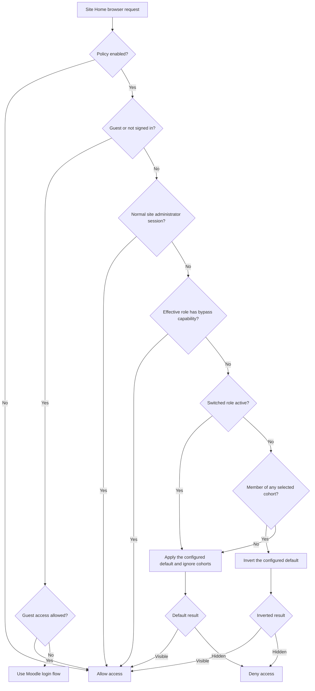

# Site Home Access

Site Home Access (`local_sitehomeaccess`) adds a configurable browser-access policy to Moodle's Site Home without modifying Moodle core.

Use it when Site Home contains navigation, activities, resources, blocks, or course listings intended for selected audiences rather than every user. Access can be based on cohorts, a system-level capability, or a separate guest policy.

## Features

- allow or deny Site Home access using multiple cohorts;
- treat membership in any selected cohort as a match;
- grant an override through the `local/sitehomeaccess:bypass` capability;
- configure guest access independently;
- remove Moodle's standard Site Home primary-navigation item when access is denied;
- enforce the same decision on direct Site Home, activity, resource, block, and standard file requests;
- redirect denied authenticated users safely to Dashboard or My courses;
- preserve administrator recovery access while supporting **Log in as** and **Switch role** testing;
- store no additional personal data or copied cohort memberships.

## Requirements

- Moodle 4.5.
- PHP and database versions supported by Moodle 4.5.

## How access is decided

The plugin evaluates one central policy for navigation and direct browser access.



Policy precedence is:

1. disabled plugin;
2. guest policy;
3. normal site-administrator safety access;
4. `local/sitehomeaccess:bypass` on an effective system role;
5. selected-cohort match;
6. configured default.

When an administrator uses **Log in as**, the impersonated account is evaluated normally. During **Switch role** on Site Home, administrator and cohort bypasses are ignored so the effective role and default rule can be tested accurately.

## Policy modes

| **Who can access Site Home?** | Users outside selected cohorts | Members of any selected cohort |
|---|---:|---:|
| **Only members of selected cohorts and permitted system roles** | Denied | Allowed |
| **Everyone except members of selected cohorts** | Allowed | Denied |

Important details:

- An empty cohort selection applies the general rule to every authenticated user without a bypass.
- Membership in any selected cohort is sufficient; users do not need to belong to every selected cohort.
- A capability bypass takes precedence over cohort denial.
- Missing or deleted cohort IDs are ignored safely.
- Guest access does not use the authenticated-user cohort rule.

## Installation

1. Download or clone this repository.
2. Ensure the plugin directory is named `sitehomeaccess`.
3. Place it at `local/sitehomeaccess` in the Moodle installation.
4. Visit **Site administration > Notifications** or run:

   ```sh
   php admin/cli/upgrade.php --non-interactive
   ```

5. Confirm that **Restrict access to Site Home** remains disabled until the policy has been configured and tested.

A new installation is intentionally safe-disabled and does not change existing Site Home access or navigation.

## Configuration

Open **Site administration > Plugins > Local plugins > Site Home access**.

1. Choose **Who can access Site Home?**
2. Select zero or more cohorts. Duplicate cohort names are distinguished by their Moodle context.
3. Choose whether visitors who are not logged in may access Site Home.
4. If required, grant `local/sitehomeaccess:bypass` to an appropriate role at system context.
5. Test the intended audiences.
6. Enable **Restrict access to Site Home**.

Site administrators retain access in normal sessions. Other users may receive access when one of their system roles has the **Always access Site Home** permission. Course-level role assignments do not provide the system-level override.

### Example: selected cohorts only

To make Site Home available only to one or more selected audiences:

1. choose **Only members of selected cohorts and permitted system roles**;
2. select every cohort that should receive access;
3. set guest access to **Require them to log in**;
4. enable the policy after testing.

### Example: visible except for selected cohorts

To keep Site Home generally available while excluding particular audiences:

1. choose **Everyone except members of selected cohorts**;
2. select every cohort that should be denied;
3. configure guest access independently;
4. enable the policy after testing.

## What is protected

| Surface | Behaviour when denied |
|---|---|
| Moodle primary navigation | The standard `home` node is removed from the navigation tree. |
| Site Home and its sections | Authenticated users are redirected to Dashboard, or My courses if Dashboard is disabled. |
| Activities and resources on Site Home | Standard rendered browser pages use the same access decision. |
| Blocks belonging to Site Home | Site Home block contexts use the same access decision. |
| Files served through `pluginfile.php` | Moodle's file-not-found response is returned without redirecting or revealing file existence. |
| Guests denied by policy | Moodle's normal login flow is used. |

Ordinary courses, course activities, course-category pages, Dashboard, My courses, user profiles, login, logout, and site-administration pages are not Site Home content and are not restricted by this plugin.

The plugin resolves the actual Moodle context and its course ancestor. It does not treat every page whose default page object happens to use the site course as Site Home.

## Theme behaviour

The standard Moodle primary-navigation node is removed rather than hidden with CSS. Themes that render Moodle's normal primary-navigation tree inherit this behaviour.

A custom theme may provide a separate hard-coded Site Home, logo, or short-site-name link. The plugin does not rewrite arbitrary theme links, but following such a link does not bypass server-side enforcement.

## Security boundary and limitations

This plugin provides browser access control for Moodle Site Home. It is not a universal security boundary for highly sensitive information.

It protects:

- standard Site Home browser routes;
- standard rendered activity and resource pages in Site Home contexts;
- standard Moodle files served through `pluginfile.php` in Site Home contexts.

It cannot guarantee interception of:

- custom download or response endpoints implemented by every third-party activity plugin;
- official Moodle app requests;
- generic token-authenticated web-service calls;
- arbitrary links rendered independently by custom themes.

Do not place highly sensitive material on Site Home solely in reliance on this plugin. Evaluate third-party plugins and non-browser integrations separately.

## Emergency recovery

The policy is disabled by default, and normal site administrators retain access. If an incorrect policy still prevents administrative access, disable enforcement from the Moodle command line:

```sh
php admin/cli/cfg.php --component=local_sitehomeaccess --name=enabled --set=0
```

If command-line configuration is unavailable, temporarily rename `local/sitehomeaccess`, restore access using the site's normal recovery process, then return the directory to its correct name before completing Moodle's plugin checks.

## Privacy and data handling

The plugin stores only:

- whether enforcement is enabled;
- the authenticated-user default rule;
- the guest rule;
- selected cohort IDs.

It does not store user IDs, email addresses, copied cohort memberships, access decisions, history, analytics, or tracking information. Existing role and cohort membership data is read only while evaluating a request. No data is sent to external services.

The plugin implements Moodle's Privacy API null-provider declaration.

## Testing

Release 1.0.0 was validated on Moodle 4.5.11+ with PHP 8.3.36 using PostgreSQL 16.14 and MySQL 8.4.11.

Automated coverage includes:

- default-visible and default-hidden policies;
- single and multiple cohort matches;
- malformed and deleted cohort IDs;
- guest, administrator, capability, impersonation, and switched-role behaviour;
- Site Home course, module, block, and file contexts;
- navigation removal and retention;
- configuration and browser access workflows.

For deployment acceptance, test with a site administrator, each intended permitted audience, an ordinary denied account, a guest, **Log in as**, and **Switch role** while Moodle developer debugging is enabled.

## Support and security reports

- Report functional defects through [GitHub Issues](https://github.com/Portvgal/moodle-local_sitehomeaccess/issues).
- Report security vulnerabilities privately through [GitHub Security Advisories](https://github.com/Portvgal/moodle-local_sitehomeaccess/security/advisories/new).

Do not include credentials, personal data, access tokens, or other sensitive information in a public issue.

## Licence and copyright

Copyright © 2026 Portvgal.

This plugin is licensed under the GNU General Public License, version 3 or later. See [LICENSE](LICENSE) for the full licence text.

## Release packaging

The distributable archive must contain one top-level directory named `sitehomeaccess`. Install that directory at `local/sitehomeaccess` in Moodle 4.5.
